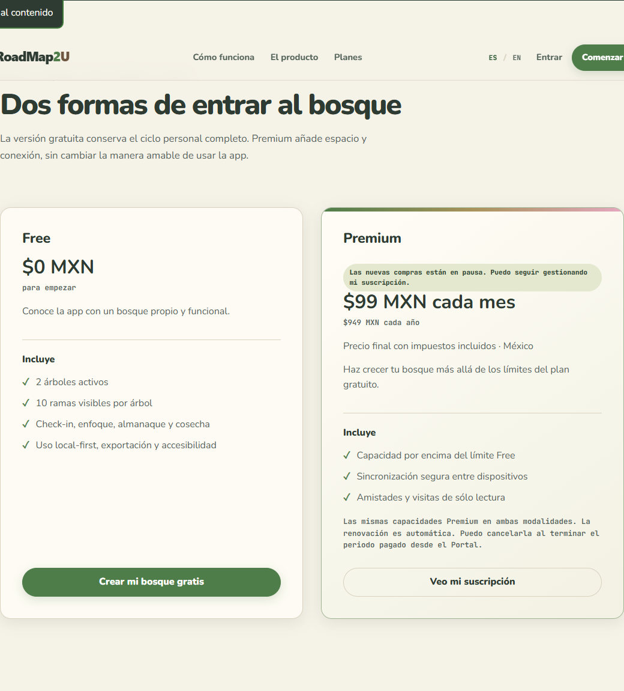
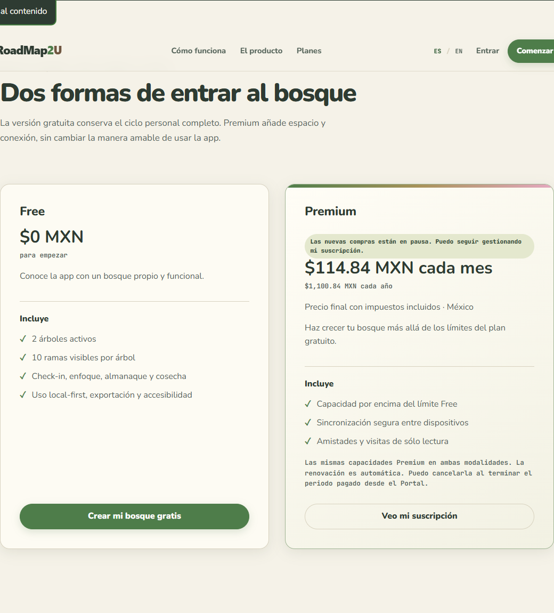

# Comparación de precios individuales

Capturas locales de la sección de planes, en español y con movimiento reducido. Ambas páginas usan configuración mock y compras cerradas.

| Base publicada 5df9e65 | Candidato de aplicación 3854987 |
| --- | --- |
|  |  |

Los nuevos totales incluyen el impuesto; los datos históricos y el catálogo v1 se conservan. Las capturas no acreditan configuración Stripe, despliegue ni aprobación fiscal de producción.

La interfaz final se comprobó con node tools/run-battery.mjs auth sync billing billing-private-cloud public-shell public-legal, resultado 6/6 y exit 0, además de 529 pruebas de aplicación y 122 de configuración.
