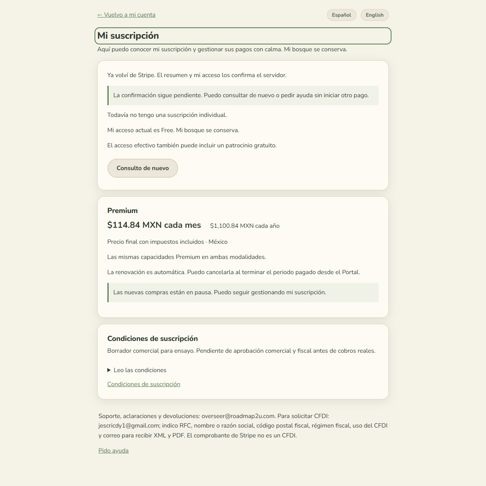
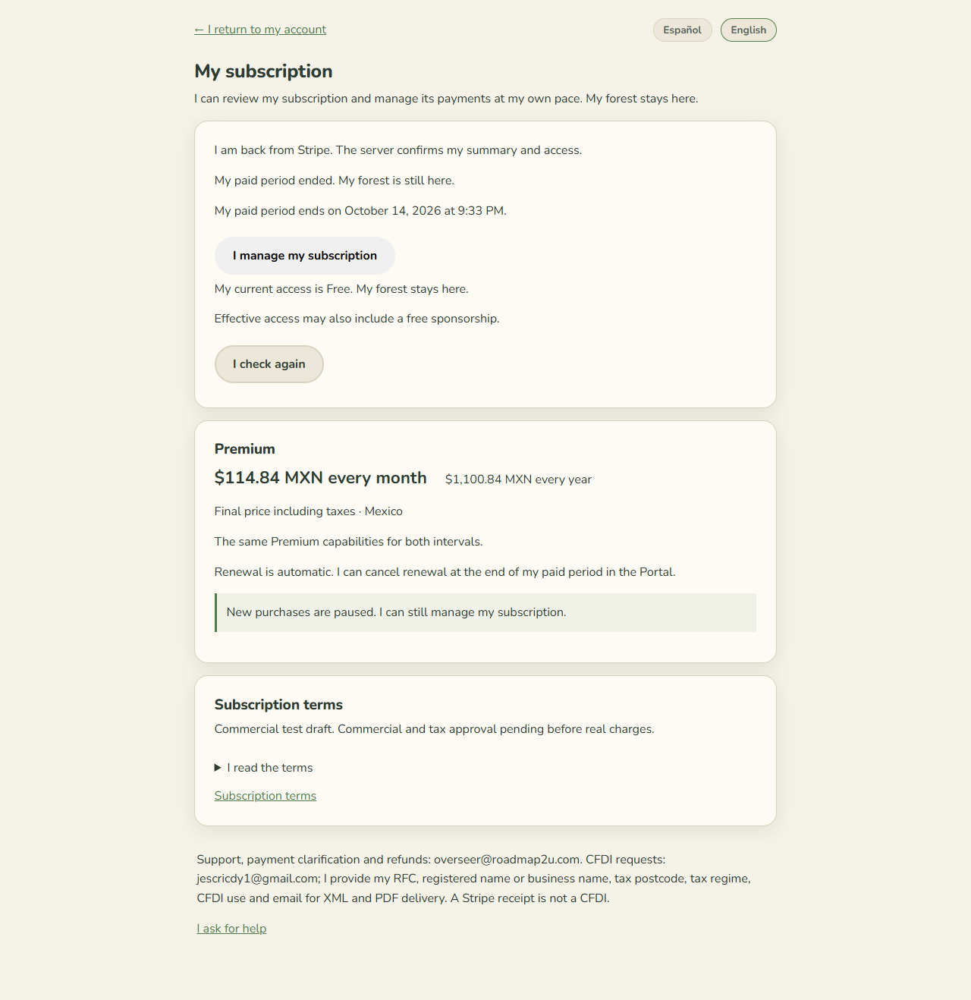
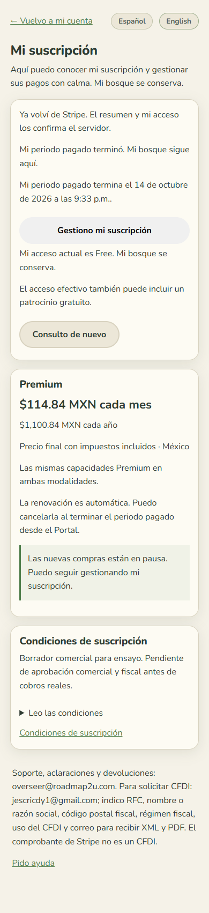

# Billing UI review evidence

These existing screenshots come from the local mock browser battery for PWA
source `8a16b90498f9aadb1f26e4b0972bc339bf191f44` (version 0.0.131), recorded in the
14 October 2026 caller/PWA checkpoint. They contain synthetic local provider
facts. The copies preserve the original PNG bytes; no screenshots were edited.

The six recorded critical probes passed: auth, billing, billing-private-cloud,
sync, public-legal and public-shell. Reproduce with the normal SPA server and:

```text
node tools/run-battery.mjs auth billing billing-private-cloud sync public-legal public-shell
```

## Before server confirmation

Returning from Checkout keeps Free while confirmation remains pending; a return
URL does not grant Premium. New purchases remain closed.



## After the paid period

The expired local scenario retains the forest and shows Free, including mobile
layout and the bilingual subscription page.





These images document normal mock PWA regressions. They do not depict a physical
Stripe test-clock run or accept the new simulation banner in a hosted DEV/TEST
session. The scoped financial clock, matching revisions, evidence expiry and
offline Free behavior have separate Angular service/component tests. Full
authenticated and visual temporal PWA acceptance in DEV/TEST remains pending.
