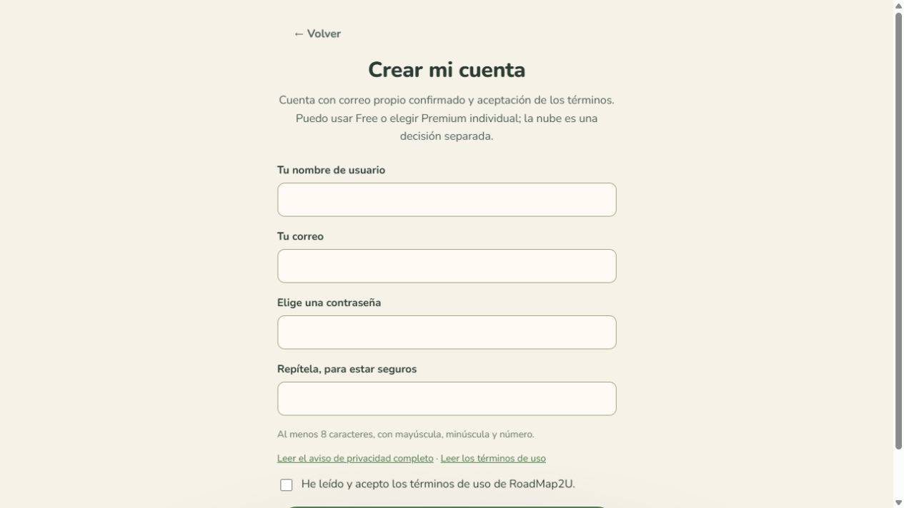

# Common account launch — local review

Scope: standard own-account signup, Free and individual Premium without age selection; verified email and affirmative account/subscription consent remain. Cloud consent is separate. Known supervised/private accounts are retained, not migrated.

## Verification

- Application full run: 653 passing tests, zero skipped; subsequent isolated changes have focused passing regressions. CI must run the entire final committed candidate before merge.
- Configuration run: 144 passing tests, zero skipped.
- Backend: 353 passing focused tests across 21 suites, typecheck, contract parity and preview-source guards passed. The earlier exploratory full run was stopped as stale after a corrected contract-hash fixture failure; it is not a passing full run. Full immutable CI remains mandatory.
- Final production build, PWA and initial-bundle adapter checks passed.
- Local browser journeys: signup/email confirmation/password recovery, sync, bilingual mobile signup, public legal documents, existing private privacy and billing/cloud coverage passed. Synthetic isolated data only; no actual payment, code operation or cloud customer record was created.
- Historical privacy payload hashes and all four retained/current ES/EN subscription hashes match their immutable texts.

## Review criteria

| Criterion | Result | Evidence |
| --- | --- | --- |
| Blindspots | PASS | Reload, language, owner-switch, worker retry, withdrawn admission, closure and private-majority cases. |
| Clarity | PASS | Common account admission separated from proven adulthood and optional cloud consent. |
| Maintainability | PASS | Existing APIs, stores, services and workflows reused; no new infrastructure. |
| Security | PASS | Current identity, document hash/version, revision/CAS, replay and off/enforce authority boundaries checked independently. |
| Performance | PASS | No historical-table scans; existing source resolution and private configuration remain scoped. |
| Documentation | PASS | Manual, API companion, owner guidance and immutable document availability updated. |
| Standards | PASS | Bilingual copy, type checks, local browser and PWA gates retained. |

Fixed findings include common cloud decision owner/document continuity; response-document validation; language/version links and active navigation; preserved historical private-majority admission; transactional checkout eligibility; truthful Portal summaries; and common consent archival.

Unaddressed: 0. No findings deferred.

## Release constraints

Publication and promotion were explicitly authorized by the owner after successful verification. CI, immutable contract locking and ordinary DEV→TEST→PROD gates are still mandatory. Configuration changes are limited to matching subscription terms and the existing PROD commercial approval reference; prices, keys, sales admission and sponsored data are preserved. No live payment or redemption is part of release verification.

